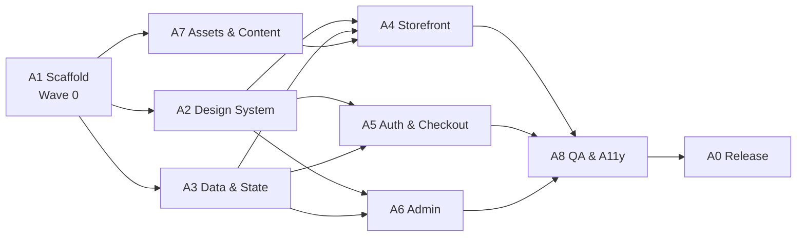

# Fishcommerce — Agent Specifications

**Version:** 1.0

This document splits the build into **nine module-scoped agents** that can work in parallel without stepping on each other. Each agent has a mission, owned files, inputs, deliverables, acceptance criteria and a ready-to-paste starter prompt. It is tool-agnostic: an "agent" is one AI coding session (Antigravity, Claude Code, Cursor, Copilot, or similar), or a human developer following the same brief.

---

## 1. How to Use This Document

1. Run `setup_project.ps1` first. It creates the Vite project, installs dependencies and generates **stub files with the correct names and an `Owner` note** (this is Agent A1's work, already done for you). See `RUNNING.md`.
2. Start agents in **wave order** (§3). Agents within a wave can run at the same time, each in its own session or branch.
3. For each agent: open a new session, paste the **Common Brief** (§4) and that agent's **Starter Prompt** (§6), and attach the docs it lists under *Reads*.
4. Before merging a wave, run the **gate checks** (§9).
5. Anything that changes a shared contract goes through the **Change Request** process (§8).

## 2. Roster

| ID | Agent | Mission (one line) | Wave |
|---|---|---|---|
| A0 | **Orchestrator** | Sequence the waves, approve change requests, merge, run the gates | all |
| A1 | **Scaffold and Routing** | Project skeleton, `App.jsx` providers and routes, build config | 0 (done by script) |
| A2 | **Design System and Shared UI** | Tokens, global CSS, Navbar, Footer, Modal, Toast, CartDrawer | 1 |
| A3 | **Data and State** | Seed data, utils, all four contexts and their contracts | 1 |
| A4 | **Storefront** | Home, Catalog, ProductDetail, ProductCard, FilterBar | 2 |
| A5 | **Auth and Checkout** | Auth page, Checkout, OrderSuccess | 2 |
| A6 | **Admin Portal** | AdminLayout, AdminProducts, AdminOrders | 2 |
| A7 | **Assets and Content** | Product images, logo, SVGs, Care/About copy, seed descriptions | 1 (continues into 2) |
| A8 | **QA and Accessibility** | Test plan execution, a11y/contrast audit, bug reports | 3 (and spot checks) |

## 3. Execution Plan



| Wave | Agents (parallel) | Starts when | Gate to exit |
|---|---|---|---|
| 0 | A1 | Immediately (script) | **G1:** `npm run dev` shows stub pages and all routes resolve |
| 1 | A2, A3, A7 | G1 passed | **G2:** tokens and shared UI exist; context contracts implemented; seed and images present |
| 2 | A4, A5, A6 | G2 passed (A4 and A5 can start once A3's contracts exist, even before A3 is fully done, by coding against `SYSTEM_ARCHITECTURE.md` §6) | **G3:** storefront flow works end to end. **G4:** admin flow works |
| 3 | A8 (A0 integrates) | G3 and G4 | **G5:** all verification cases pass; a11y audit clean |

Relative effort: A1 S · A2 M · A3 M · A4 M · A5 M · A6 L · A7 M · A8 M.

## 4. Common Brief (paste into every agent session)

> You are building **Fishcommerce**, a client-side React (Vite) pet-fish store with a storefront and admin portal. Read the documents listed in your spec before writing code.
>
> **Rules**
> 1. **Own only your files.** Edit only the paths in your *Owns* list. If you need a change elsewhere, write a Change Request (spec §8) instead of editing.
> 2. **Contracts are law.** Context method names, parameters and return shapes in `SYSTEM_ARCHITECTURE.md` §6, and data shapes in `DATABASE_SCHEMA.md`, must not change. Code against them even if the other agent has not finished (use a temporary local mock if needed, and delete it before handoff).
> 3. **Requirement IDs.** Implement the `FR-*` IDs assigned to you. Do not add features that are not in the requirements.
> 4. **Styling.** Use CSS variables from `index.css` only (no hex literals). One CSS file per component. BEM-style class names. Mobile-first with `min-width` queries at 600/900/1024px. Wrap animations for `prefers-reduced-motion`.
> 5. **Accessibility is not optional.** Semantic HTML, labelled controls, visible focus, keyboard operable, text contrast ≥ 4.5:1.
> 6. **Persistence.** Never touch `localStorage` directly. Use contexts and `utils/storage.js`.
> 7. **Dependencies.** Runtime deps are `react`, `react-dom`, `react-router-dom` only. Do not add packages.
> 8. **Money and IDs.** Use `utils/money.js` for all price maths and display, and `utils/id.js` for IDs. Never use raw floating-point addition for prices.
> 9. **Definition of Done.** Your acceptance criteria are met, `npm run build` passes with no errors or warnings you introduced, the browser console is clean on your pages, and you have written a **Handoff Note** (§7).
> 10. **Be honest.** If something is blocked, ambiguous or untested, say so in the Handoff Note. Do not claim a flow works unless you ran it.

## 5. File Ownership Matrix

Single-writer ownership prevents merge conflicts. "Reads" means import or consume only.

| Path | Owner | Notes |
|---|---|---|
| `package.json`, `vite.config.js`, `index.html`, `.gitignore`, `public/_redirects` | A1 | |
| `src/main.jsx`, `src/App.jsx` | A1 | A0 may edit to wire in finished pieces |
| `src/index.css` | A2 | Global tokens, reset, `.btn-*`, `.badge`, `.card`, `.container` |
| `src/components/Navbar.*`, `Footer.*`, `Modal.*`, `Toast.*`, `CartDrawer.*` | A2 | |
| `src/config.js`, `src/utils/*` | A3 | |
| `src/data/fishData.js` | A3 | Structure and numbers: A3. Description text and image filenames: A7 supplies |
| `src/context/*` | A3 | |
| `src/components/ProductCard.*`, `FilterBar.*` | A4 | |
| `src/pages/Home.*`, `Catalog.*`, `ProductDetail.*`, `NotFound.*` | A4 | |
| `src/pages/Auth.*`, `Checkout.*`, `OrderSuccess.*` | A5 | |
| `src/pages/admin/*` | A6 | |
| `public/images/**`, `src/assets/**` | A7 | |
| `src/pages/Care.*`, `About.*` | A7 | |
| `*.md` docs, `setup_project.ps1` | A0 | |
| Test reports, bug reports | A8 | Writes to `docs/qa/` only (create if needed) |

## 6. Agent Specifications

---

### A0 — Orchestrator

**Mission:** Keep the build coherent. Decide order, resolve conflicts, protect the contracts.

**Reads:** all docs.
**Owns:** docs, `setup_project.ps1`; may touch `App.jsx` for integration.

**Responsibilities**
- Launch waves in order and confirm gate criteria (§9) before releasing the next wave.
- Review and approve or reject Change Requests (§8); update the affected doc when approved.
- Merge agent branches in this order: A1 → A3 → A2 → A7 → A4 → A5 → A6 → A8 fixes.
- Resolve disagreements by the precedence: `PROJECT_REQUIREMENTS.md` (decisions log) > `SYSTEM_ARCHITECTURE.md` > `DATABASE_SCHEMA.md` > mockups > agent preference.
- Keep a running list of open Handoff Notes and unresolved bugs.

**Done when:** gate G5 passes and `README.md` and `RUNNING.md` match reality.

**Starter prompt**
```
You are A0, the Orchestrator for Fishcommerce. Read AGENT_SPECIFICATIONS.md and all project docs.
Your job: run the waves in §3 in order, check each gate in §9, review Change Requests, merge branches in the
order given in your spec, and keep docs accurate. Do not write feature code yourself except to wire finished
modules into App.jsx. After each wave, report: what passed, what failed, what is blocked.
```

---

### A1 — Scaffold and Routing

**Mission:** A running skeleton so every other agent starts from the same ground truth.

**Reads:** `SYSTEM_ARCHITECTURE.md` §3–§5, §13.
**Owns:** `package.json`, `vite.config.js`, `index.html`, `.gitignore`, `public/_redirects`, `src/main.jsx`, `src/App.jsx`.

**Deliverables**
- [ ] Vite + React project with `react-router-dom` installed.
- [ ] Folder structure exactly as `SYSTEM_ARCHITECTURE.md` §4.
- [ ] Stub component for every page, component and context so all imports resolve.
- [ ] `App.jsx`: provider nesting (§6), `BrowserRouter`, `SiteLayout` (Navbar, `<main id="main-content">`, Footer, CartDrawer), all routes from §5, lazy admin routes, scroll-to-top, error boundary.
- [ ] `index.html` with Plus Jakarta Sans link and page title.

**Acceptance:** `npm run dev` starts; every route in §5 renders a stub; `/nope` shows NotFound; `npm run build` passes.

**Status:** produced by `setup_project.ps1`. Re-run or review only if the structure changes.

**Starter prompt**
```
You are A1 (Scaffold and Routing). Create the Vite + React project and the exact folder layout in
SYSTEM_ARCHITECTURE.md §4, with stub files for every module, provider nesting per §6, and the route table
per §5 (admin routes lazy-loaded, /admin guarded later by A6). Install only react-router-dom beyond the Vite defaults.
Finish with `npm run build` passing and a Handoff Note.
```

---

### A2 — Design System and Shared UI

**Mission:** One visual language, implemented once, used everywhere.

**Reads:** `PROJECT_REQUIREMENTS.md` §7 (tokens, typography, components, motion), `SYSTEM_ARCHITECTURE.md` §6.1, §6.4, §9.
**Owns:** `src/index.css`, `Navbar`, `Footer`, `Modal`, `Toast`, `CartDrawer` (JSX and CSS).
**Implements:** FR-GEN-01…07, FR-CART-01, 02, 03, 06.

**Deliverables**
- [ ] `index.css`: all tokens from §7.1, reset, base typography, `.container`, `.btn-primary`, `.btn-secondary`, `.btn-outline`, `.btn-danger-outline`, `.badge` (+ status variants), `.card`, `.visually-hidden`, `.skip-link`, global `:focus-visible`, reduced-motion rule.
- [ ] `Navbar`: sticky, links, cart icon plus count badge (from `useCart().itemCount`), auth control from `useAuth()` (Login link, or name + dropdown with Admin Dashboard and Logout), hamburger menu.
- [ ] `Footer`: 3 columns, gradient accent.
- [ ] `Modal`: reusable `{ isOpen, onClose, title, children, size }`, focus trap, `Esc`, backdrop click, return focus.
- [ ] `Toast`: exports `ToastProvider` and `useToast()` per contract §6.1; container with `aria-live`; 4s auto-dismiss.
- [ ] `CartDrawer`: slide-over wired to `useCart()`; stepper, remove, subtotal, Checkout button; uses `Modal`-style focus management.
- [ ] A short `/* usage */` comment block at the top of `index.css` listing the utility classes.

**Acceptance:** keyboard-only navigation of Navbar, drawer and modal works; contrast of all token pairings ≥ 4.5:1 for text; layout holds at 375px, 768px, 1440px.

**Out of bounds:** page layouts, product-specific components.

**Starter prompt**
```
You are A2 (Design System and Shared UI) for Fishcommerce. Read PROJECT_REQUIREMENTS.md §7 and
SYSTEM_ARCHITECTURE.md §6.1/§6.4/§9. Implement src/index.css (tokens, reset, button/badge/card utilities, focus ring,
reduced-motion), Navbar, Footer, Modal, Toast (ToastProvider + useToast per contract), and CartDrawer.
Own only those files. Use the exact token names from §7.1. Everything must be keyboard accessible and responsive
(375/768/1440). Code against the context contracts even if A3 is not finished. Finish with a Handoff Note listing
every class and prop other agents can use.
```

---

### A3 — Data and State

**Mission:** The single source of truth. Implement the contracts exactly.

**Reads:** `SYSTEM_ARCHITECTURE.md` §6–§7, §10; `DATABASE_SCHEMA.md` (all); `PROJECT_REQUIREMENTS.md` §4, §6.
**Owns:** `src/config.js`, `src/utils/*`, `src/data/fishData.js`, `src/context/*`.
**Implements:** FR-AUTH-01…05, FR-DATA-01…05, FR-CART-04, 05, and the data parts of FR-CHK-05, FR-ADM-03, FR-AO-04, FR-AP-*.

**Deliverables**
- [ ] `config.js`, `utils/storage.js` (with `initStorage` and migrations), `money.js`, `id.js` (the setup script generates working first versions; review and extend).
- [ ] `utils/validators.js` implementing every rule in `PROJECT_REQUIREMENTS.md` §6.
- [ ] `fishData.js`: the 14 products in `DATABASE_SCHEMA.md` §7. Use description text from A7 when delivered, with a one-line placeholder until then.
- [ ] `AuthContext`, `ProductContext`, `CartContext`, `OrderContext` matching §6.2–§6.5 signatures and result-object convention.
- [ ] Cross-tab sync via `storage.subscribe` in each context; `OrderContext.latestIncoming`.
- [ ] `placeOrder` follows `DATABASE_SCHEMA.md` §8.2 exactly (re-read, validate, snapshot, two writes with rollback).
- [ ] Cart reconciliation (FR-CART-05).
- [ ] Context values memoised.

**Acceptance (verified in a scratch script or the browser console):**
- Seeded catalog appears on a fresh profile; survives reload.
- `placeOrder` with insufficient stock writes nothing.
- 3 × $3.99 + $24.99 + $5.99 = exactly `42.95`.
- Status cannot skip or go backwards.
- Corrupt `fc_cart` JSON does not crash the app.
- Two tabs: order in tab A raises `pendingCount` in tab B.

**Out of bounds:** any JSX other than provider wrappers.

**Starter prompt**
```
You are A3 (Data and State) for Fishcommerce. Implement config.js, utils (storage, money, id, validators), fishData.js
(the 14 products in DATABASE_SCHEMA.md §7), and the four contexts exactly as specified in SYSTEM_ARCHITECTURE.md §6
and DATABASE_SCHEMA.md §8. Return result objects ({ok:true,...} / {ok:false,error:{code,message}}) and never throw for
expected failures. Use cents-safe money maths. Write-through persistence plus storage-event sync in every context.
Do not change any signature in the contract. Prove your work with a short list of console checks you ran, and write a
Handoff Note with any deviation.
```

---

### A4 — Storefront

**Mission:** Make browsing and choosing a fish delightful.

**Reads:** `PROJECT_REQUIREMENTS.md` §3.2–§3.4, §7; `SYSTEM_ARCHITECTURE.md` §5, §6.3–§6.4; A2 and A7 handoff notes.
**Owns:** `Home`, `Catalog`, `ProductDetail`, `NotFound`, `ProductCard`, `FilterBar` (JSX and CSS).
**Implements:** FR-HOME-01…04, FR-CAT-01…07, FR-PDP-01…08, FR-GEN-05.

**Deliverables**
- [ ] `Home`: hero gradient, copy, two CTAs, animated Betta tank (CSS keyframes, SVG from A7), trust strip.
- [ ] `FilterBar`: pill toggles (water type, care level) and search input; controlled by Catalog. State lives in URL query params (`useSearchParams`).
- [ ] `ProductCard`: per FR-CAT-06, with image fallback and sold-out state.
- [ ] `Catalog`: header, search, filters, responsive grid, empty state with Clear filters, result count (`aria-live`).
- [ ] `ProductDetail`: 55/45 layout, specs box, stock badge, quantity selector, **Adopt / Order Now** (add + navigate), **Add to Cart** (add + open drawer + toast), unknown-id state.
- [ ] `NotFound`.

**Acceptance:** mockups 1, 2, 3, 9, 10 matched visually at 1440 and 390; filters AND-combine and survive reload; out-of-stock CTA disabled; no layout shift when images load.

**Out of bounds:** cart, checkout and admin logic; editing contexts.

**Starter prompt**
```
You are A4 (Storefront) for Fishcommerce. Read PROJECT_REQUIREMENTS.md §3.2–3.4 and §7, and SYSTEM_ARCHITECTURE.md §5–6.
Build Home, Catalog, ProductDetail, NotFound, ProductCard and FilterBar using the A2 design tokens/utilities and the
useProducts/useCart contracts. Catalog filters live in URL query params (?type=&care=&q=). Match the mockup descriptions
at 1440px and 390px. Images need width/height, loading="lazy" and an onError placeholder. Own only your files. End with a
Handoff Note listing what you tested and in which viewport sizes.
```

---

### A5 — Auth and Checkout

**Mission:** A trustworthy, low-friction path from cart to confirmed order.

**Reads:** `PROJECT_REQUIREMENTS.md` §3.6–§3.8, §6; `SYSTEM_ARCHITECTURE.md` §6.2, §6.4–§6.5, §8.1, §8.3; `DATABASE_SCHEMA.md` §8.2.
**Owns:** `Auth`, `Checkout`, `OrderSuccess` (JSX and CSS).
**Implements:** FR-AUTH-01…08 (UI side), FR-CHK-01…07, FR-ORD-01…03.

**Deliverables**
- [ ] `Auth`: tabbed Sign In / Create Account, password toggle, inline validation via `validators`, Continue as Guest (sets `sessionStorage.fc_guest_checkout`), return-path redirect.
- [ ] `Checkout`: empty-cart redirect, auth-gate modal (uses A2 `Modal`), form with prefill and validation, order summary, flat shipping, **Confirm & Place Order** with double-submit protection and `STOCK` error handling.
- [ ] `OrderSuccess`: animated check, reference with copy button, items, total, contact, banner, Continue Shopping; refresh-safe via `sessionStorage.fc_last_order_id`.

**Acceptance:** mockups 4, 5, 6 matched; guest and logged-in paths both complete; first invalid field focused on submit; totals equal the mockup example ($42.95); after success the cart is empty and stock decreased.

**Out of bounds:** context internals; admin screens.

**Starter prompt**
```
You are A5 (Auth and Checkout) for Fishcommerce. Read PROJECT_REQUIREMENTS.md §3.6–3.8 and §6, and the order flow in
SYSTEM_ARCHITECTURE.md §8.1/§8.3. Build Auth, Checkout and OrderSuccess using useAuth, useCart, useOrders and the shared
Modal/Toast. Support guest checkout (sessionStorage flag), return-path after login, field-level validation with accessible
errors, double-submit protection, and a STOCK-failure path. Match mockups 4–6. Own only your three pages. Finish with a
Handoff Note covering the guest path, the logged-in path and a stock-conflict test.
```

---

### A6 — Admin Portal

**Mission:** Give the store owner control without code.

**Reads:** `PROJECT_REQUIREMENTS.md` §3.9–§3.11, §6, §7.3; `SYSTEM_ARCHITECTURE.md` §5, §6.3, §6.5, §7.4, §8.2.
**Owns:** `src/pages/admin/*`.
**Implements:** FR-ADM-01…04, FR-AP-01…07, FR-AO-01…07.

**Deliverables**
- [ ] `AdminLayout`: guard (`<Navigate>`), deep-violet top bar with bell and avatar, tab nav (`NavLink`), `<Outlet/>`, `latestIncoming` → toast, `/admin` → `/admin/products`.
- [ ] `AdminProducts`: table, Add/Edit modal form (all fields, validation, image preview), availability switch, delete with confirm.
- [ ] `AdminOrders` with `view` prop (`pending` or `history`): per D-03; columns per FR-AO-03; status pills; one contextual forward action; toast; expandable row for notes and status history.
- [ ] Responsive tables in scroll containers.

**Acceptance:** mockups 7 and 8 matched; non-admin redirected; adding a product shows it in the catalog immediately; with two tabs, an order placed in the customer tab raises the bell and shows a toast in the admin tab; Delivered orders appear only in History.

**Out of bounds:** storefront files; changing context signatures.

**Starter prompt**
```
You are A6 (Admin Portal) for Fishcommerce. Read PROJECT_REQUIREMENTS.md §3.9–3.11 and decision D-03, and
SYSTEM_ARCHITECTURE.md §5, §6.3, §6.5, §7.4. Build AdminLayout (declarative route guard, top bar, tabs, new-order toast
from useOrders().latestIncoming), AdminProducts (CRUD table + modal form, availability switch, confirm delete) and
AdminOrders (view="pending"|"history", forward-only status buttons, toasts, expandable details). Use shared Modal/Toast.
Own only src/pages/admin/*. Test with two browser tabs. End with a Handoff Note.
```

---

### A7 — Assets and Content

**Mission:** Make the store look and read like a real shop.

**Reads:** `PROJECT_REQUIREMENTS.md` §3.2, §3.13, §7; `DATABASE_SCHEMA.md` §7.
**Owns:** `public/images/**`, `src/assets/**`, `Care`, `About` (JSX and CSS).
**Implements:** FR-CNT-01, FR-CNT-02, FR-HOME-02 and FR-HOME-03 assets.

**Deliverables**
- [ ] 14 product images at `public/images/fish/<id>.png` (or `.jpg`/`.webp`), square, ≤ 150 KB, with filenames matching the seed `id`s, plus `placeholder.svg`. Use generated or licensed images only, and record the source and licence of each in `public/images/CREDITS.md`.
- [ ] Logo (text logo SVG) and a Betta fish SVG with separable parts (body, fins, tail) for the CSS swim animation.
- [ ] 5 grayscale partner marks as simple, **fictional** SVGs. Do not reproduce real brands' logos.
- [ ] 14 seed descriptions, 2–3 sentences each (behaviour, origin, tank mates), factually careful because these are live animals. Deliver as a markdown or JS array to A3.
- [ ] `Care` page (water types, cycling, acclimation, feeding, tank sizing) and `About` page.

**Acceptance:** every seed `image` path resolves; images are the right size; copy is accurate, friendly, and free of unsupported claims (e.g. "guaranteed to live").

**Starter prompt**
```
You are A7 (Assets and Content) for Fishcommerce. Produce: 14 square product images named by the seed ids in
DATABASE_SCHEMA.md §7 (public/images/fish/, ≤150KB each) plus placeholder.svg; a text logo SVG; a Betta SVG with separable
fin/tail parts for CSS animation; five fictional grayscale partner marks (no real brand logos); 14 factual product
descriptions (2–3 sentences, careful because these are live animals); and the Care and About pages. Record image sources in
public/images/CREDITS.md. Own only the paths in your spec. Hand the descriptions to A3 in a markdown file.
```

---

### A8 — QA and Accessibility

**Mission:** Prove it works, and prove it works for everyone.

**Reads:** everything; especially `implementation_plan_full.md` §5 (test cases) and `PROJECT_REQUIREMENTS.md` §5, §7.
**Owns:** `docs/qa/*` (reports only). **Does not edit source**; files bugs to the owning agent.

**Deliverables**
- [ ] Executed run of all cases TC-01…TC-24 in `implementation_plan_full.md` §5 with pass/fail and evidence (notes or screenshots).
- [ ] Responsive check at 375, 768, 1024, 1440px.
- [ ] Accessibility audit: keyboard-only walkthrough of every flow, focus order, labels, contrast check of every token pairing (especially badge text on lavender), `prefers-reduced-motion`, screen-reader smoke test of the cart drawer, modals and toasts.
- [ ] Lighthouse run (performance and accessibility) with scores recorded.
- [ ] Bug reports (§7 template) assigned to owners; re-test after fixes.
- [ ] Final sign-off report to A0.

**Acceptance:** gate G5 (§9).

**Starter prompt**
```
You are A8 (QA and Accessibility) for Fishcommerce. Do not edit source files. Run the test cases in
implementation_plan_full.md §5, check responsive behaviour at 375/768/1024/1440, audit accessibility (keyboard,
focus, labels, contrast of every token pairing, reduced motion), and run Lighthouse. File each defect using the bug template
in AGENT_SPECIFICATIONS.md §7 assigned to the owning agent per the ownership matrix. Re-test fixes. Report only what you
actually ran, with evidence, and finish with a sign-off or a list of blockers.
```

---

## 7. Handoff Note and Bug Templates

**Handoff Note** (every agent, when done):

```
Agent: A_
Branch/commit: _
Requirement IDs completed: FR-_, FR-_
Files changed: _
Public surface others can use: (props, classes, functions)
Tested: (what you ran, viewport sizes, browsers)
Not tested / known issues: _
Deviations from spec (with reason): _
Needs from other agents: _
```

**Bug report** (A8 → owner):

```
ID: BUG-###      Severity: Blocker | Major | Minor | Cosmetic
Owner: A_        Requirement: FR-_
Steps to reproduce: 1. … 2. …
Expected: _      Actual: _
Environment: browser/version, viewport
Evidence: screenshot / console output
```

## 8. Change Request Process

Used when an agent needs something outside its files, or a contract must change.

```
CR-###  From: A_   To: A0 (and owner A_)
Need: (what and why)
Impact: (files, contracts, other agents)
Proposed change: (exact signature or diff)
Workaround if rejected: _
```

A0 decides within the same wave. Approved contract changes are written into `SYSTEM_ARCHITECTURE.md` §6 or `DATABASE_SCHEMA.md` **before** any agent codes against them, and every affected agent is notified.

## 9. Gate Checklists

| Gate | Checks |
|---|---|
| **G1 Scaffold** | `npm install` clean; `npm run dev` serves on :5173; all routes render; `/nope` → NotFound; `npm run build` passes |
| **G2 Foundations** | `index.css` tokens match §7.1; Navbar, Footer, Modal, Toast, CartDrawer render and are keyboard operable; all four contexts implement the §6 contracts; seed loads; 14 images present |
| **G3 Storefront** | Home → Catalog (filter, search) → Detail → Add/Order Now → Checkout (guest and logged in) → Success; stock decremented; console clean |
| **G4 Admin** | Guard works; add/edit/toggle/delete product reflects in the catalog; new order in another tab raises bell and toast; status flows Pending → Delivered; History tab correct |
| **G5 Release** | All TC cases pass; Lighthouse accessibility ≥ 95; no Blocker/Major bugs open; `README.md` and `RUNNING.md` verified by following them from a clean clone |

## 10. Anti-Patterns to Reject in Review

- Reading or writing `localStorage` outside `utils/storage.js`.
- Hex colours or magic spacing numbers in component CSS.
- `price * quantity` or `a + b` on prices instead of the money helpers.
- Mutating state in place; navigating inside `useEffect` for guards.
- Adding a package without approval.
- One agent "fixing" another agent's file instead of filing a Change Request or bug.
- Claiming a flow works without running it.
