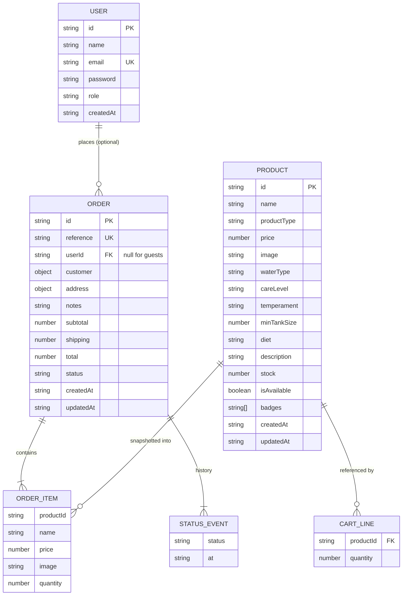

# Fishcommerce — Database Schema

**Version:** 1.0 · **Schema version constant:** `SCHEMA_VERSION = 1`

Fishcommerce has **no database server**. Persistence is browser `localStorage`, accessed only through `src/utils/storage.js`. This document defines the "tables" (storage keys), their record shapes, validation, seed data, invariants, and a relational mapping (§12) for when a backend is added.

Related: `SYSTEM_ARCHITECTURE.md` (§7 persistence layer) · `PROJECT_REQUIREMENTS.md` (§6 validation rules, §2 decisions D-01…D-15).

---

## 1. Conventions

- All keys are prefixed `fc_` (`STORAGE_PREFIX` in `src/config.js`). Code passes the unprefixed name (`'products'`) to `storage.js`, which adds the prefix.
- Values are JSON. Dates are ISO 8601 UTC strings (`new Date().toISOString()`).
- IDs are strings. Seed products use readable slugs (`crown-tail-betta`). New products, users and orders use `newId()` (UUID with a fallback).
- Money is a JS number in major units with at most 2 decimals. Arithmetic always goes through `utils/money.js` (D-14).
- Field names are `camelCase`. Enum values are Title Case strings, exactly as shown in the UI.

## 2. Key Registry

| Storage key | Type | Owner (writes) | Description |
|---|---|---|---|
| `fc_meta` | object | `storage` bootstrap | `{ schemaVersion, seededAt }` |
| `fc_products` | `Product[]` | ProductContext | Catalog. Seeded from `fishData.js` on first load |
| `fc_users` | `User[]` | AuthContext | Registered customers |
| `fc_session` | `Session \| null` | AuthContext | Currently logged-in user (null = guest) |
| `fc_cart` | `CartLine[]` | CartContext | Current cart |
| `fc_orders` | `Order[]` | OrderContext | All placed orders, newest first |

`sessionStorage` (per tab, cleared when the tab closes):

| Key | Description |
|---|---|
| `fc_guest_checkout` | `"1"` if the shopper chose "Continue as guest" |
| `fc_last_order_id` | ID of the order just placed, so `/order-success` survives a refresh |

## 3. Entity-Relationship Diagram



`ORDER_ITEM`, `STATUS_EVENT`, `customer` and `address` are **embedded** in the order record (no separate keys). `ORDER_ITEM.productId` is a soft reference; the product may later be deleted.

## 4. Entities

### 4.1 Product — `fc_products`

| Field | Type | Req | Notes |
|---|---|---|---|
| `id` | string | ✔ | Unique. Seed: slug. New: `newId()` |
| `name` | string | ✔ | 2–60 chars, unique (case-insensitive) |
| `productType` | enum | ✔ | `fish` \| `food`; defaults to `fish` for existing products |
| `price` | number | ✔ | > 0, ≤ 99,999, 2 dp |
| `image` | string | ✔ | Stable path (`/images/fish/betta.png`) or `http(s)` URL |
| `gallery` | string[] |  | Optional extra images (FR-PDP-07) |
| `waterType` | enum | Fish only | `Freshwater` \| `Saltwater` (D-01) |
| `careLevel` | enum | Fish only | `Beginner` \| `Intermediate` \| `Expert` |
| `temperament` | enum | Fish only | `Peaceful` \| `Semi-Aggressive` \| `Aggressive` |
| `minTankSize` | integer | Fish only | Gallons, 1–1,000 |
| `diet` | string | ✔ | Fish diet or food type, ≤ 60 chars |
| `description` | string | ✔ | 10–600 chars |
| `stock` | integer | ✔ | 0–9,999 |
| `isAvailable` | boolean | ✔ | Admin switch. Hidden from the catalog when false |
| `badges` | string[] |  | Marketing badges, e.g. `["Best Seller"]`, max 3 |
| `createdAt`, `updatedAt` | ISO string | ✔ | Set by ProductContext |

Derived (never stored): `isPurchasable = isAvailable && stock > 0`.

### 4.2 User — `fc_users`

| Field | Type | Req | Notes |
|---|---|---|---|
| `id` | string | ✔ | `newId()` |
| `name` | string | ✔ | 2–60 chars |
| `email` | string | ✔ | Lower-cased, unique |
| `password` | string | ✔ | **Plaintext in v1, demo only.** See §10 |
| `role` | enum | ✔ | `customer` (the admin is **not** stored here, see 4.3) |
| `createdAt` | ISO string | ✔ | |

### 4.3 Session — `fc_session`

```json
{ "userId": "a1b2…", "name": "Asha", "email": "asha@example.com", "role": "customer" }
```

The hard-coded admin (`DEMO_ADMIN` in `config.js`) produces `{ "userId": "admin", "name": "Admin", "email": "admin@fishcommerce.com", "role": "admin" }`. The password is never stored in the session. `null` or a missing key means guest.

### 4.4 CartLine — `fc_cart`

| Field | Type | Notes |
|---|---|---|
| `productId` | string | Must reference a product; reconciled on load (FR-CART-05) |
| `quantity` | integer | 1..stock. The cart stores no prices; they come from the live product |

### 4.5 Order — `fc_orders`

| Field | Type | Req | Notes |
|---|---|---|---|
| `id` | string | ✔ | UUID (internal) |
| `reference` | string | ✔ | `FC-YYYYMMDD-XXXX`, unique (D-12) |
| `userId` | string \| null | ✔ | Null for guests |
| `items` | `OrderItem[]` | ✔ | 1 or more. Snapshot lines (below) |
| `customer` | `{ name, phone, email }` | ✔ | Entered at checkout |
| `address` | `{ street, city, postalCode }` | ✔ | |
| `notes` | string |  | ≤ 500 chars, "" if none |
| `subtotal`, `shipping`, `total` | number | ✔ | `total = subtotal + shipping` |
| `status` | enum | ✔ | `Pending` \| `Confirmed` \| `Shipped` \| `Delivered` |
| `statusHistory` | `{ status, at }[]` | ✔ | First entry is `Pending` at creation |
| `createdAt`, `updatedAt` | ISO string | ✔ | |

`OrderItem`: `{ productId, name, price, image, quantity }`, a snapshot taken at order time (BR-05).

## 5. Enumerations

| Enum | Values |
|---|---|
| `waterType` | `Freshwater`, `Saltwater` |
| `careLevel` | `Beginner`, `Intermediate`, `Expert` |
| `temperament` | `Peaceful`, `Semi-Aggressive`, `Aggressive` |
| `status` | `Pending`, `Confirmed`, `Shipped`, `Delivered` |
| `role` | `customer`, `admin` |

Allowed status transitions (forward only): `Pending → Confirmed → Shipped → Delivered`. `Delivered` is terminal.

## 6. Validation Rules

Defined once in `PROJECT_REQUIREMENTS.md` §6 and implemented in `src/utils/validators.js` (owned by the Data & State agent). Contexts must re-validate on write. Never trust the form alone.

## 7. Seed Data (`src/data/fishData.js`)

14 products. Images are generated or placeholder files in `public/images/fish/<id>.png` (fallback: a single `placeholder.svg`). Descriptions (2–3 sentences each, covering behaviour, origin and tank mates) are written by the Assets & Content agent. All seed products have `isAvailable: true`, and `createdAt` and `updatedAt` are set when seeding.

| `id` | Name | Water | Price | Care | Temperament | Min tank (gal) | Diet | Stock | Badges |
|---|---|---|---:|---|---|---:|---|---:|---|
| `crown-tail-betta` | Crown Tail Betta | Freshwater | 24.99 | Beginner | Semi-Aggressive | 5 | Flakes & Pellets | 18 | Best Seller |
| `neon-tetra` | Neon Tetra | Freshwater | 3.99 | Beginner | Peaceful | 10 | Flakes & Micro Pellets | 120 | Schooling |
| `fancy-guppy` | Fancy Guppy | Freshwater | 4.99 | Beginner | Peaceful | 5 | Flakes | 80 | |
| `fancy-goldfish` | Fancy Goldfish | Freshwater | 6.99 | Beginner | Peaceful | 20 | Flakes & Pellets | 40 | |
| `panda-corydoras` | Panda Corydoras | Freshwater | 7.99 | Beginner | Peaceful | 20 | Sinking Pellets | 35 | |
| `dwarf-gourami` | Dwarf Gourami | Freshwater | 9.99 | Intermediate | Peaceful | 10 | Flakes | 25 | |
| `angelfish` | Angelfish | Freshwater | 14.99 | Intermediate | Semi-Aggressive | 29 | Flakes & Frozen Foods | 22 | |
| `discus` | Discus | Freshwater | 79.99 | Expert | Peaceful | 55 | Pellets & Bloodworms | 6 | Rare |
| `silver-arowana` | Silver Arowana | Freshwater | 249.99 | Expert | Aggressive | 250 | Carnivore (Frozen/Live) | 3 | Rare |
| `ocellaris-clownfish` | Ocellaris Clownfish | Saltwater | 29.99 | Beginner | Peaceful | 20 | Pellets & Mysis Shrimp | 30 | New |
| `royal-gramma` | Royal Gramma | Saltwater | 24.99 | Beginner | Peaceful | 30 | Pellets & Frozen Foods | 15 | |
| `yellow-tang` | Yellow Tang | Saltwater | 49.99 | Intermediate | Semi-Aggressive | 75 | Marine Algae & Nori | 12 | |
| `blue-tang` | Blue Tang | Saltwater | 59.99 | Intermediate | Peaceful | 100 | Marine Algae & Nori | 9 | |
| `mandarin-dragonet` | Mandarin Dragonet | Saltwater | 44.99 | Expert | Peaceful | 30 | Live Copepods | 5 | Rare |

Notes:
- The first two rows reproduce mockup 4 exactly: Crown Tail Betta × 1 + Neon Tetra × 3 = $36.96, plus $5.99 shipping = **$42.95**.
- The Betta's temperament deviates from the mockup (D-10).
- Seed stock numbers are illustrative; edit freely.

## 8. Operations and Invariants

### 8.1 Invariants (must always hold)

1. `product.stock >= 0`.
2. Every cart line satisfies `1 <= quantity <= product.stock` after reconciliation.
3. `order.total == order.subtotal + order.shipping` (cents-exact).
4. `order.statusHistory` is non-empty; its last entry equals `order.status`; entries are in forward order.
5. `order.reference` values are unique.
6. `users[].email` values are unique (case-insensitive).
7. Orders are append-only except `status`, `statusHistory` and `updatedAt`.

### 8.2 Place order (atomic in effect)

`OrderContext.placeOrder(orderData)`:

1. **Re-read** `products` and `orders` from storage (not React state) to handle changes from other tabs.
2. For each requested line: the product must exist, be `isAvailable`, and have `stock >= quantity`. If any line fails, return `{ ok:false, error:{ code:'STOCK', lines:[…] } }` and **write nothing**.
3. Build `items[]` snapshots; compute `subtotal` (cents-safe), `shipping = SHIPPING_FLAT`, `total`.
4. Create the order: `id`, unique `reference`, `status:'Pending'`, `statusHistory:[{status:'Pending', at:now}]`.
5. Write `products` (stock decremented), then write `orders` (`[order, …existing]`). If the second write fails, restore the first write and return `{ ok:false, error:{ code:'STORAGE' } }`.
6. Update React state, set `sessionStorage.fc_last_order_id`, return `{ ok:true, order }`. The caller then clears the cart.

### 8.3 Update order status

`updateOrderStatus(orderId, nextStatus)` only accepts the next status in the forward chain, appends to `statusHistory`, and updates `status` and `updatedAt`. Anything else returns `{ ok:false, error:{ code:'INVALID_TRANSITION' } }`.

### 8.4 Delete product

Removes the record from `fc_products`. Orders are untouched (snapshots). Cart lines for it are removed on the next reconciliation.

### 8.5 Sign up and log in

Sign-up lower-cases the email and rejects duplicates, including `admin@fishcommerce.com`. Login first checks `DEMO_ADMIN`, then looks up `fc_users`. Credential failures return `INVALID_CREDENTIALS` without saying which field was wrong.

## 9. Versioning and Migrations

`fc_meta.schemaVersion` records the schema the data was written with.

On app start (`initStorage()` in `utils/storage.js`):

1. If `fc_meta` is missing → first run: write `fc_meta { schemaVersion: SCHEMA_VERSION, seededAt: now }`. `ProductContext` then seeds `fc_products` from `fishData.js` because that key is absent.
2. If `schemaVersion < SCHEMA_VERSION` → run migrations `migrations[v]` in order (pure functions that rewrite the stored keys), then update `fc_meta`.
3. If `schemaVersion > SCHEMA_VERSION` (user downgraded) → leave data untouched and show the warning banner.
4. Corrupt JSON for a key → `readJSON` returns the fallback; the app continues with defaults and the one-time warning (FR-DATA-03).

Rule: any change to a stored shape bumps `SCHEMA_VERSION` and adds a migration.

## 10. Security Notes (v1)

- `password` is stored in plaintext and the admin password is in source code. This is acceptable only because the app is a local demo with no real accounts.
- `localStorage` is readable by any script on the same origin. Never store payment data or real secrets.
- A production backend must hash passwords (argon2id or bcrypt), authenticate with sessions or JWT, and authorise admin routes server-side.

## 11. Capacity and Sync

- Browsers allow about 5 MB per origin. Estimated usage: 14 products ≈ 8 KB, 1,000 orders ≈ 1.2 MB. Because images are URLs and paths (never base64), capacity is not a concern. `writeJSON` returns `false` on quota errors and callers surface a toast.
- **Cross-tab sync:** the `storage` event fires in other tabs when a key changes. `storage.subscribe(key, cb)` wraps it. ProductContext, CartContext, AuthContext and OrderContext each subscribe to their own key, so an order placed in tab A appears in an admin tab B (FR-ADM-03). The event does **not** fire in the tab that made the change.

## 12. Future Relational Schema (PostgreSQL)

Use this when replacing `localStorage` with an API. Each `fc_*` key maps to a table; embedded arrays and objects become child tables or columns.

```sql
CREATE TYPE water_type  AS ENUM ('Freshwater', 'Saltwater');
CREATE TYPE care_level  AS ENUM ('Beginner', 'Intermediate', 'Expert');
CREATE TYPE temperament AS ENUM ('Peaceful', 'Semi-Aggressive', 'Aggressive');
CREATE TYPE order_status AS ENUM ('Pending', 'Confirmed', 'Shipped', 'Delivered');
CREATE TYPE user_role   AS ENUM ('customer', 'admin');

CREATE TABLE users (
  id            UUID PRIMARY KEY DEFAULT gen_random_uuid(),
  name          VARCHAR(60)  NOT NULL,
  email         VARCHAR(120) NOT NULL UNIQUE,   -- store lower-cased
  password_hash TEXT         NOT NULL,          -- argon2id / bcrypt
  role          user_role    NOT NULL DEFAULT 'customer',
  created_at    TIMESTAMPTZ  NOT NULL DEFAULT now()
);

CREATE TABLE products (
  id            TEXT PRIMARY KEY,               -- slug or UUID
  name          VARCHAR(60)  NOT NULL UNIQUE,
  price_cents   INTEGER      NOT NULL CHECK (price_cents > 0),
  image_url     TEXT         NOT NULL,
  water_type    water_type   NOT NULL,
  care_level    care_level   NOT NULL,
  temperament   temperament  NOT NULL,
  min_tank_gal  INTEGER      NOT NULL CHECK (min_tank_gal BETWEEN 1 AND 1000),
  diet          VARCHAR(60)  NOT NULL,
  description   TEXT         NOT NULL,
  stock         INTEGER      NOT NULL CHECK (stock >= 0),
  is_available  BOOLEAN      NOT NULL DEFAULT TRUE,
  badges        TEXT[]       NOT NULL DEFAULT '{}',
  gallery       TEXT[]       NOT NULL DEFAULT '{}',
  created_at    TIMESTAMPTZ  NOT NULL DEFAULT now(),
  updated_at    TIMESTAMPTZ  NOT NULL DEFAULT now()
);
CREATE INDEX idx_products_filter ON products (water_type, care_level) WHERE is_available;

CREATE TABLE orders (
  id              UUID PRIMARY KEY DEFAULT gen_random_uuid(),
  reference       VARCHAR(20)  NOT NULL UNIQUE,
  user_id         UUID REFERENCES users(id) ON DELETE SET NULL,   -- NULL = guest
  customer_name   VARCHAR(60)  NOT NULL,
  customer_phone  VARCHAR(20)  NOT NULL,
  customer_email  VARCHAR(120) NOT NULL,
  street          VARCHAR(120) NOT NULL,
  city            VARCHAR(60)  NOT NULL,
  postal_code     VARCHAR(10)  NOT NULL,
  notes           TEXT         NOT NULL DEFAULT '',
  subtotal_cents  INTEGER      NOT NULL,
  shipping_cents  INTEGER      NOT NULL,
  total_cents     INTEGER      NOT NULL,
  status          order_status NOT NULL DEFAULT 'Pending',
  created_at      TIMESTAMPTZ  NOT NULL DEFAULT now(),
  updated_at      TIMESTAMPTZ  NOT NULL DEFAULT now(),
  CHECK (total_cents = subtotal_cents + shipping_cents)
);
CREATE INDEX idx_orders_status_created ON orders (status, created_at DESC);

CREATE TABLE order_items (
  id          BIGSERIAL PRIMARY KEY,
  order_id    UUID    NOT NULL REFERENCES orders(id) ON DELETE CASCADE,
  product_id  TEXT,                              -- soft ref, product may be deleted
  name        VARCHAR(60) NOT NULL,              -- snapshot
  price_cents INTEGER NOT NULL,                  -- snapshot
  image_url   TEXT    NOT NULL,                  -- snapshot
  quantity    INTEGER NOT NULL CHECK (quantity > 0)
);

CREATE TABLE order_status_events (
  id        BIGSERIAL PRIMARY KEY,
  order_id  UUID         NOT NULL REFERENCES orders(id) ON DELETE CASCADE,
  status    order_status NOT NULL,
  at        TIMESTAMPTZ  NOT NULL DEFAULT now()
);
```

Mapping notes:
- **Money** becomes integer cents (`price_cents`). The front end then converts at the API boundary.
- **Cart** moves to a `carts` and `cart_items` pair if server-side carts are wanted. Otherwise it stays in the client.
- **Place order** becomes one SQL transaction: `SELECT … FOR UPDATE` on the products, decrement stock, insert order, items and the first status event.
- **Suggested REST surface:** `GET /products`, `POST /products` (admin), `PATCH /products/:id` (admin), `DELETE /products/:id` (admin), `POST /orders`, `GET /orders` (admin), `PATCH /orders/:id/status` (admin), `POST /auth/signup`, `POST /auth/login`. Each corresponds to one context method in `SYSTEM_ARCHITECTURE.md` §6, so the contexts can swap `storage` calls for `fetch` calls without changing any page.

## 13. Sample Documents

```json
// fc_products[0]
{
  "id": "crown-tail-betta",
  "name": "Crown Tail Betta",
  "price": 24.99,
  "image": "/images/fish/crown-tail-betta.png",
  "waterType": "Freshwater",
  "careLevel": "Beginner",
  "temperament": "Semi-Aggressive",
  "minTankSize": 5,
  "diet": "Flakes & Pellets",
  "description": "A striking crown-tail variety with fringed, spiky fins…",
  "stock": 18,
  "isAvailable": true,
  "badges": ["Best Seller"],
  "createdAt": "2026-11-04T09:00:00.000Z",
  "updatedAt": "2026-11-04T09:00:00.000Z"
}
```

```json
// fc_orders[0]
{
  "id": "5d1c2f9e-3b7a-4c58-9d2e-1a6f0c8b7e44",
  "reference": "FC-20261104-A7K3",
  "userId": null,
  "items": [
    { "productId": "crown-tail-betta", "name": "Crown Tail Betta", "price": 24.99, "image": "/images/fish/crown-tail-betta.png", "quantity": 1 },
    { "productId": "neon-tetra", "name": "Neon Tetra", "price": 3.99, "image": "/images/fish/neon-tetra.png", "quantity": 3 }
  ],
  "customer": { "name": "John Doe", "phone": "+91 98765 43210", "email": "john@example.com" },
  "address": { "street": "12 Lake View Road", "city": "Chennai", "postalCode": "600001" },
  "notes": "5-gallon tank already cycled.",
  "subtotal": 36.96,
  "shipping": 5.99,
  "total": 42.95,
  "status": "Pending",
  "statusHistory": [{ "status": "Pending", "at": "2026-11-04T09:30:00.000Z" }],
  "createdAt": "2026-11-04T09:30:00.000Z",
  "updatedAt": "2026-11-04T09:30:00.000Z"
}
```
