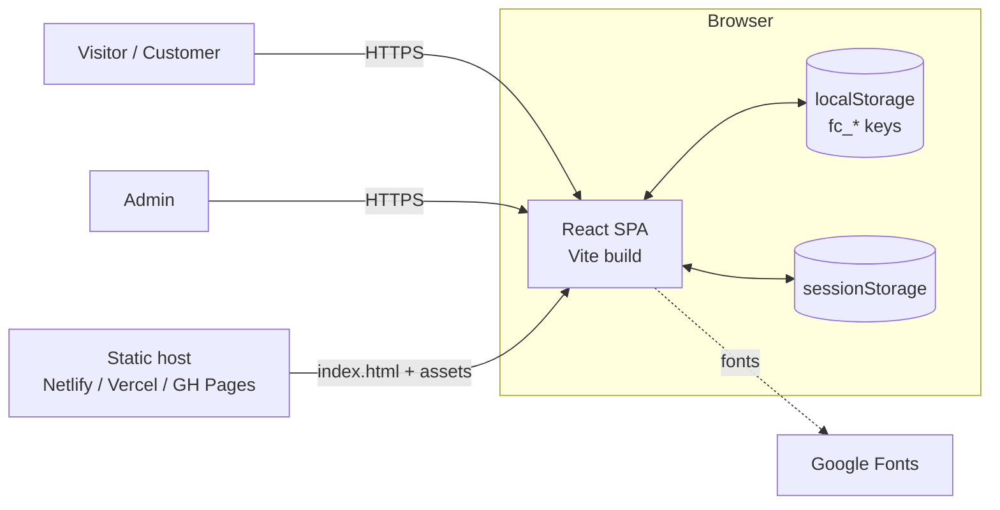
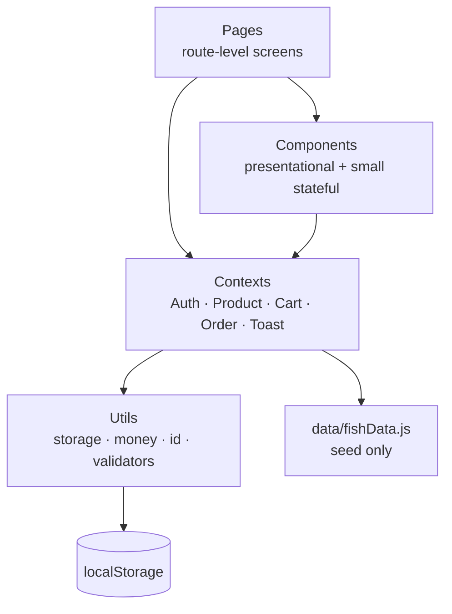
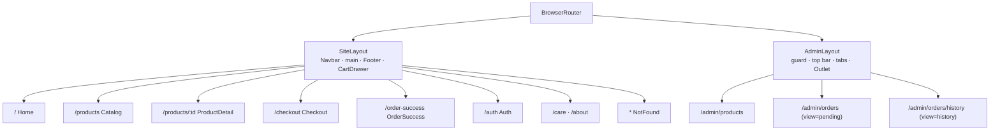
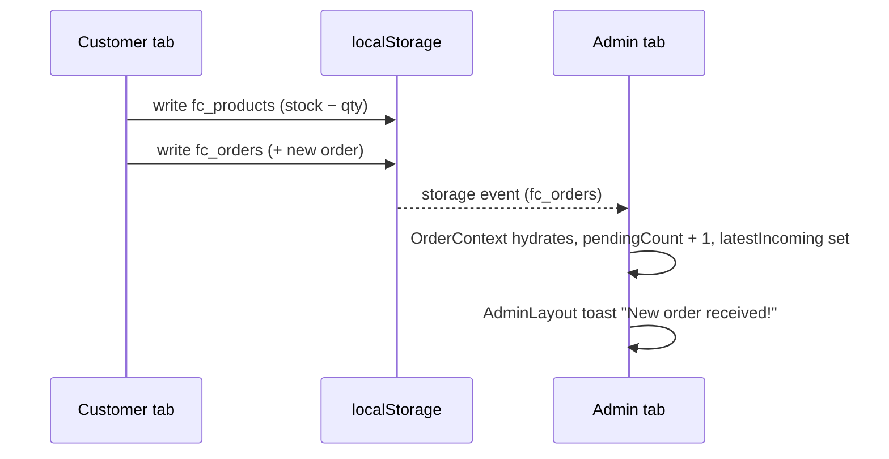
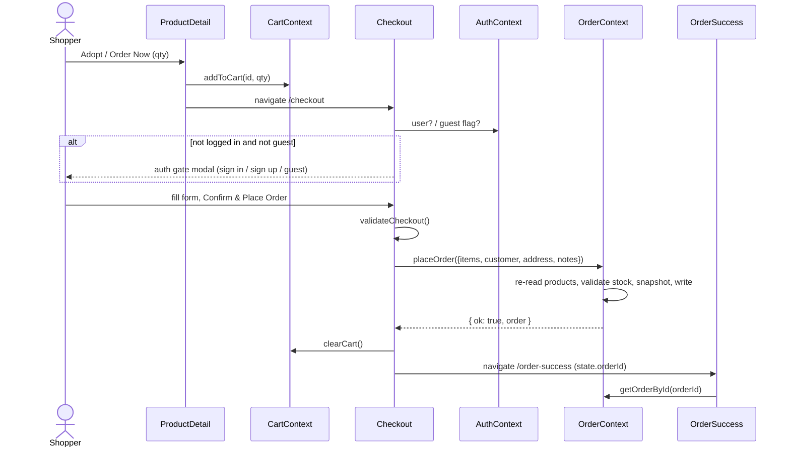
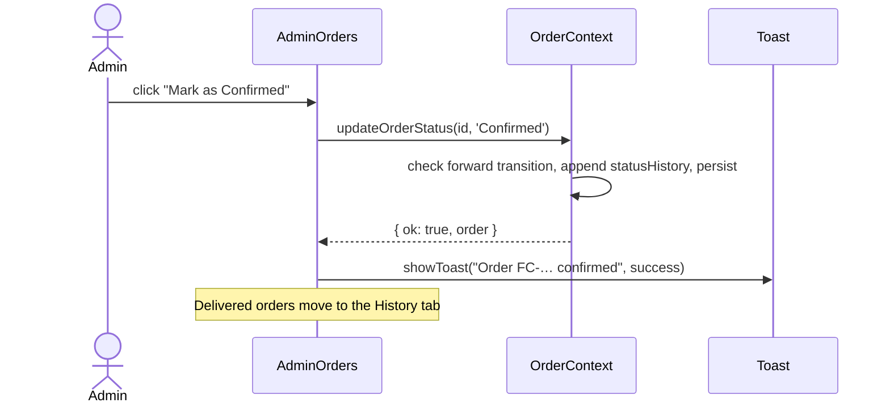
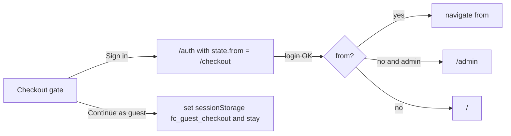

# Fishcommerce — System Architecture

**Version:** 1.0 · **Audience:** developers and build agents

Fishcommerce is a **client-only single-page application**. There is no server code: React renders the UI, React Context holds state, and `localStorage` persists it. This document covers structure, state contracts, flows and constraints. Data shapes live in `DATABASE_SCHEMA.md`; behaviour lives in `PROJECT_REQUIREMENTS.md`.

---

## 1. System Context



The only network traffic is loading static files and the Google Fonts stylesheet. Customer and admin share one browser profile's storage, so the "admin sees customer orders" behaviour works only on the same browser (two tabs or windows). That is the intended demo scope.

## 2. Architectural Style

A layered SPA with one-way dependencies:



Rules:
1. Pages and components **never** touch `localStorage` directly. They go through contexts.
2. Contexts never import pages or components (except `Toast.jsx` exporting its own provider).
3. Pure helpers (`money`, `id`, `validators`) have no React or DOM dependencies, so they are trivially testable.
4. A context may depend on another only in this order: `Toast` ← `Auth` ← `Product` ← `Cart` ← `Order`.

## 3. Tech Stack

| Layer | Choice | Notes |
|---|---|---|
| Build / dev server | **Vite** (+ `@vitejs/plugin-react`) | Dev port 5173 |
| UI | **React** (function components, hooks) | Latest stable (19.x at time of writing) |
| Routing | **React Router v7** via `react-router-dom` | `BrowserRouter`, nested routes, `Outlet` |
| State | React Context + `useReducer` | No external state library |
| Persistence | `localStorage` (+ `sessionStorage` for two flags) | Via `utils/storage.js` |
| Styling | Vanilla CSS, one file per component, tokens in `:root` | No CSS framework |
| Fonts | Plus Jakarta Sans (Google Fonts) | `display=swap`, system fallback |
| Animation | CSS keyframes and transitions | No animation library |

## 4. Project Structure

Additions to the original plan are marked ➕ (see `PROJECT_REQUIREMENTS.md` §2).

```
Fish_commerce/
├── index.html                       # root HTML, font <link>, #root
├── vite.config.js
├── package.json
├── public/
│   ├── images/fish/                 # ➕ stable product image paths (D-07)
│   └── _redirects                   # ➕ SPA fallback for Netlify
└── src/
    ├── main.jsx                     # mounts <App/>
    ├── App.jsx                      # providers + BrowserRouter + routes
    ├── index.css                    # tokens, reset, global/utility classes
    ├── config.js                    # ➕ constants (currency, shipping, demo admin)
    ├── data/
    │   └── fishData.js              # seed array (14 products)
    ├── utils/                       # ➕
    │   ├── storage.js               #   safe JSON read/write/subscribe + migrations
    │   ├── money.js                 #   cents-safe math + formatPrice
    │   ├── id.js                    #   newId, newOrderReference
    │   └── validators.js            #   form + entity validation (PROJECT_REQUIREMENTS §6)
    ├── context/
    │   ├── AuthContext.jsx
    │   ├── ProductContext.jsx
    │   ├── CartContext.jsx
    │   └── OrderContext.jsx
    ├── components/
    │   ├── Navbar.jsx/.css
    │   ├── Footer.jsx/.css
    │   ├── CartDrawer.jsx/.css      # ➕
    │   ├── ProductCard.jsx/.css
    │   ├── FilterBar.jsx/.css
    │   ├── Modal.jsx/.css
    │   └── Toast.jsx/.css           # exports ToastProvider + useToast
    ├── pages/
    │   ├── Home.jsx/.css
    │   ├── Catalog.jsx/.css
    │   ├── ProductDetail.jsx/.css
    │   ├── Checkout.jsx/.css
    │   ├── OrderSuccess.jsx/.css
    │   ├── Auth.jsx/.css
    │   ├── Care.jsx/.css            # ➕
    │   ├── About.jsx/.css           # ➕
    │   ├── NotFound.jsx/.css        # ➕
    │   └── admin/
    │       ├── AdminLayout.jsx/.css
    │       ├── AdminProducts.jsx/.css
    │       └── AdminOrders.jsx/.css
    └── assets/                      # logo and brand SVGs (not product images)
```

## 5. Routing and Layouts



| Route | Component | Guard / behaviour |
|---|---|---|
| `/` | `Home` | — |
| `/products` | `Catalog` | Reads `?type=&care=&q=` |
| `/products/:id` | `ProductDetail` | Unknown or unavailable id → friendly state |
| `/checkout` | `Checkout` | Empty cart → redirect `/products`; auth gate modal |
| `/order-success` | `OrderSuccess` | No recent order → redirect `/products` |
| `/auth` | `Auth` | After success → `location.state.from` or `/` (admin → `/admin`) |
| `/care`, `/about` | static pages | — |
| `/admin` | `AdminLayout` (lazy) | **Guard:** non-admin → `<Navigate to="/auth" state={{from}}>`; index → `/admin/products` |
| `/admin/products` | `AdminProducts` | — |
| `/admin/orders` | `AdminOrders view="pending"` | Active orders (D-03) |
| `/admin/orders/history` | `AdminOrders view="history"` | Delivered orders |
| `*` | `NotFound` | — |

Admin routes are loaded with `React.lazy` so customers do not download admin code. Guards render `<Navigate>` (declarative); they do not navigate inside effects.

## 6. State Management: Context Contracts

**These signatures are the integration contract between agents.** Implementations may add internals but must not change names, parameters or return shapes without an approved change request (`AGENT_SPECIFICATIONS.md` §8).

Provider nesting in `App.jsx` (outermost first):

```jsx
<ToastProvider>
  <AuthProvider>
    <ProductProvider>
      <CartProvider>
        <OrderProvider>
          <BrowserRouter> … </BrowserRouter>
        </OrderProvider>
      </CartProvider>
    </ProductProvider>
  </AuthProvider>
</ToastProvider>
```

All mutating methods return a **result object**: `{ ok: true, …data }` or `{ ok: false, error: { code, message, … } }`. They never throw for expected failures.

### 6.1 `useToast()`: `components/Toast.jsx`

```ts
{
  showToast(message: string, opts?: { type?: 'info'|'success'|'error', duration?: number }): string // returns id
  dismissToast(id: string): void
}
```

### 6.2 `useAuth()`: `context/AuthContext.jsx`

```ts
{
  user: { id, name, email, role: 'customer'|'admin' } | null,   // null = guest
  isAuthenticated: boolean,
  isAdmin: boolean,
  login(email: string, password: string):            Result<{ user }>,   // INVALID_CREDENTIALS
  signup(name: string, email: string, password: string): Result<{ user }>, // EMAIL_TAKEN | VALIDATION
  logout(): void
}
```

Admin check happens first against `DEMO_ADMIN` in `config.js`. Persists `fc_users` and `fc_session`.

### 6.3 `useProducts()`: `context/ProductContext.jsx`

```ts
{
  products: Product[],                       // all (admin view)
  availableProducts: Product[],              // isAvailable === true (storefront)
  getProductById(id: string): Product | undefined,
  addProduct(data: ProductInput):              Result<{ product }>,  // VALIDATION | DUPLICATE_NAME
  updateProduct(id: string, patch: Partial<ProductInput>): Result<{ product }>,
  deleteProduct(id: string):                   Result<{}>,
  toggleAvailability(id: string):              Result<{ product }>,
  resetToSeed(): void
}
```

Seeds from `fishData.js` when `fc_products` is absent. Stock is changed only by `OrderContext.placeOrder` (through an internal `applyStockDeltas` exposed to `OrderContext` for atomic writes, see §7.3).

### 6.4 `useCart()`: `context/CartContext.jsx`

```ts
{
  items: { productId: string, quantity: number }[],
  lines: { product: Product, quantity: number, lineTotal: number }[], // joined, reconciled
  itemCount: number,            // sum of quantities (navbar badge)
  subtotal: number,
  isOpen: boolean, openCart(): void, closeCart(): void,
  addToCart(productId: string, quantity?: number):  Result<{}>,   // OUT_OF_STOCK | UNAVAILABLE (clamps to stock)
  updateQuantity(productId: string, quantity: number): Result<{}>, // <= 0 removes
  removeFromCart(productId: string): void,
  clearCart(): void
}
```

On mount and whenever products change, the cart is reconciled (FR-CART-05) and a toast reports removals.

### 6.5 `useOrders()`: `context/OrderContext.jsx`

```ts
{
  orders: Order[],                       // newest first
  activeOrders: Order[],                 // Pending | Confirmed | Shipped
  deliveredOrders: Order[],
  pendingCount: number,                  // status === 'Pending'
  latestIncoming: { id: string, reference: string, at: number } | null,
  placeOrder(data: {
    items: { productId: string, quantity: number }[],
    customer: { name, phone, email },
    address: { street, city, postalCode },
    notes?: string
  }): Result<{ order }>,                 // STOCK | VALIDATION | STORAGE
  updateOrderStatus(orderId: string, nextStatus: Status): Result<{ order }>, // INVALID_TRANSITION | NOT_FOUND
  getOrderById(id: string): Order | undefined
}
```

`latestIncoming` is set only when an order arrives from **another tab** via the `storage` event (FR-ADM-03). `AdminLayout` watches it to fire the "New order received!" toast. Orders placed by the current tab do not set it.

### 6.6 Helper modules (pure)

```ts
// utils/money.js
toCents(n), fromCents(c), roundMoney(n), sumMoney(values[]), lineTotal(price, qty), formatPrice(n)
// utils/id.js
newId(): string, newOrderReference(date?): string
// utils/storage.js
readJSON(key, fallback), writeJSON(key, value): boolean, removeKey(key), subscribe(key, cb): unsubscribe, initStorage()
// utils/validators.js  (each returns { valid: boolean, errors: Record<field,string> })
validateSignup, validateLogin, validateCheckout, validateProduct
```

## 7. Persistence Layer

### 7.1 `utils/storage.js`

All reads and writes go through here. It wraps `JSON.parse` and `localStorage` in try/catch so private-mode, quota or corruption problems never crash the app: `readJSON` returns the supplied fallback and `writeJSON` returns `false`.

### 7.2 Context ↔ storage pattern

Each context follows the same pattern:

1. **Initial state:** `useReducer(reducer, undefined, () => readJSON(key, defaultValue))`.
2. **Write-through:** `useEffect(() => { writeJSON(key, state) }, [state])`.
3. **Cross-tab sync:** `useEffect(() => subscribe(key, (value) => dispatch({ type: 'HYDRATE', value })), [])`.

To avoid ping-pong, hydrating from a storage event must not trigger another storage write that changes the value. Writes are idempotent because `setItem` with an identical string does not fire an event.

### 7.3 Cross-context atomicity (stock + orders)

`placeOrder` must change two keys (`products`, `orders`). To keep it atomic in effect (`DATABASE_SCHEMA.md` §8.2), `OrderContext` reads the latest `products` from storage, validates, builds the new products and orders arrays, writes both (rolling back on failure), then calls `ProductContext.hydrate()` and updates its own state. `ProductContext` therefore exposes a small internal API (`hydrate`, `applyStockDeltas`) used only by `OrderContext`.

### 7.4 Cross-tab behaviour



## 8. Key Flows

### 8.1 Place an order



### 8.2 Admin fulfils an order



### 8.3 Auth with return path



## 9. Styling Architecture

- **Tokens first:** every colour, radius, shadow and font size comes from a `:root` CSS variable (`PROJECT_REQUIREMENTS.md` §7.1). No hex literals in component CSS.
- **Naming:** BEM-style class names scoped by component: `.product-card`, `.product-card__title`, `.product-card--sold-out`. Global utility classes are limited to `.btn-*`, `.badge`, `.card`, `.container`, `.visually-hidden`.
- **Breakpoints:** `600px`, `900px`, `1024px` (min-width media queries, mobile-first).
- **Layout:** CSS Grid and Flexbox. Containers are `max-width: 1200px` with inline padding of `clamp(16px, 4vw, 32px)`.
- **Motion:** every animation is wrapped so `@media (prefers-reduced-motion: reduce)` disables it.
- **Focus:** a global `:focus-visible` ring using `--accent`. Never `outline: none` without a replacement.

## 10. Error Handling and Edge Cases

| Situation | Behaviour |
|---|---|
| `localStorage` unavailable or full | `storage.js` returns fallbacks and `false`. App runs in memory and shows a one-time banner; mutations that cannot persist show an error toast |
| Corrupt JSON in a key | Treated as missing; defaults or seed are used; warning banner |
| Product removed while in a cart | Reconciliation drops the line and shows a toast |
| Stock changes between add-to-cart and checkout | `placeOrder` fails with `STOCK` and nothing is written; Checkout shows which lines changed and adjusts quantities |
| Double click on **Place Order** | Submit button disabled while pending; `placeOrder` is synchronous, so one order is created |
| Refresh on `/order-success` | Falls back to `sessionStorage.fc_last_order_id`; else redirect to `/products` |
| Direct load of a deep link on a static host | SPA fallback rewrite to `index.html` (see §13) |
| Image fails to load | `onError` swaps in `/images/fish/placeholder.svg` |
| Unknown route | `NotFound` page |

An error boundary around `<Routes>` renders a "Something went wrong" panel with a reload button instead of a white screen.

## 11. Performance

- Route-level code splitting for the admin area.
- Product images: `loading="lazy"`, `decoding="async"`, explicit `width`/`height`, each ≤ 150 KB.
- Derive filtered lists with `useMemo`. Do not store derived data in state.
- Contexts split by domain so a cart change does not re-render the whole catalog. Context values are memoised with `useMemo`.
- Fonts: preconnect plus `display=swap`; only the weights used.

## 12. Security and Privacy Posture

This is a **demo-grade** app. Known limitations (deliberate for v1):

| Limitation | Why | Production fix |
|---|---|---|
| Admin credentials are in source (`DEMO_ADMIN`) | No backend | Server-side auth with hashed passwords and role checks |
| Customer passwords stored in plaintext in `localStorage` | No backend | Never store passwords client-side; use a real auth provider |
| Admin routes are guarded only by client state | No server to enforce | Enforce authorisation in the API |
| Data visible to anyone with browser access | `localStorage` | Server-side database |

Mitigations that still apply: React escapes rendered strings by default (never use `dangerouslySetInnerHTML` with user input); admin image URLs are restricted to `http(s)` or `/path` (no `javascript:` URLs); no third-party scripts besides Google Fonts. **Do not host this publicly as a real store.**

## 13. Build and Deployment

- `npm run build` outputs static files to `dist/`. Any static host works.
- **SPA fallback** is required for deep links such as `/products/betta`:
  - Netlify: `public/_redirects` containing `/* /index.html 200` (created by the setup script).
  - Vercel: `vercel.json` with `{ "rewrites": [{ "source": "/(.*)", "destination": "/index.html" }] }`.
  - GitHub Pages: set Vite `base` to the repo name, and copy `index.html` to `404.html` after the build.
- No environment variables are needed for v1.

## 14. Evolution Path

The context layer is the seam for adding a backend. Replace each context's `storage` calls with API calls while keeping the contracts in §6, and no page needs to change. The relational design and REST surface are in `DATABASE_SCHEMA.md` §12.

## 15. Architecture Decision Records (summary)

| ADR | Decision | Reason |
|---|---|---|
| A-1 | Context + `useReducer` instead of Redux/Zustand | Four small domains; zero extra dependencies |
| A-2 | `localStorage` as the "database" | Matches the no-backend requirement; per-browser demo |
| A-3 | Result objects instead of exceptions | Predictable control flow for forms and agents |
| A-4 | Stable `public/` image paths | Avoid stale hashed URLs in stored data (D-07) |
| A-5 | Snapshot order lines | Past orders must not change when products change (BR-05) |
| A-6 | Lazy-loaded admin | Keeps the customer bundle small |
| A-7 | Plain CSS with tokens | Maximum control; consistent with the design spec |
