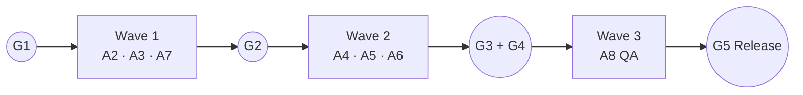

# Fishcommerce — Full Implementation Plan

**Version:** 1.0

The **delivery plan**: phases, task IDs, owners, dependencies, the complete test suite, risks and release checklist. It replaces the earlier `task.md` checklist.

| Document | Use it for |
|---|---|
| `implementation_plan.md` | What each file contains (concise) |
| `PROJECT_REQUIREMENTS.md` | Requirement IDs (`FR-*`), business rules, decisions, UX spec |
| `SYSTEM_ARCHITECTURE.md` | Structure, context contracts, flows |
| `DATABASE_SCHEMA.md` | Stored data shapes, seed data, invariants |
| `AGENT_SPECIFICATIONS.md` | Who builds what, prompts, gates |

---

## 1. Delivery Overview

- **Approach:** contract-first, parallel by module (nine agents, four waves).
- **Sizing:** S = a short session, M = a focused session, L = a long session or two. Calendar duration depends on how many agents run in parallel. With three in parallel, Waves 1 and 2 take roughly one working day each.
- **Critical path:** A1 → A3 (contracts) → A5 (checkout) → A8 (QA). A6 (admin) is the largest single module and should start as early as A3's contracts allow.

| Wave | Agents (parallel) | Relative length | Output |
|---|---|---|---|
| 0 | A1 | 1 unit | Running skeleton (G1) |
| 1 | A2, A3, A7 | 2–3 units (A7 longest) | Tokens, shared UI, contracts, seed data, assets (G2) |
| 2 | A4, A5, A6 | 2–3 units (A6 longest) | Storefront, checkout, admin (G3, G4) |
| 3 | A8, then A0 | 2 + 1 units | QA sign-off and release (G5) |

---

## 2. Phase Plan and Task Checklist

Legend: **Owner** = agent ID (`AGENT_SPECIFICATIONS.md`) · **Dep** = task IDs that must finish first · **Req** = requirement IDs.

### Phase 0 — Project Setup (Wave 0)

| ✔ | ID | Task | Owner | Dep | Size | Req |
|---|---|---|---|---|---|---|
| ☐ | T-0.1 | Run `setup_project.ps1` (Vite + React, deps, folder tree, stubs) | A1 | — | S | — |
| ☐ | T-0.2 | Confirm `npm run dev` / `npm run build` work; all routes render stubs | A1 | T-0.1 | S | FR-GEN-05 |
| ☐ | T-0.3 | Wire provider nesting, `SiteLayout`, lazy admin routes, scroll-to-top, error boundary | A1 | T-0.1 | S | FR-GEN-06 |
| ☐ | T-0.4 | **Gate G1** | A0 | T-0.2, T-0.3 | S | — |

### Phase 1 — Foundations (Wave 1)

| ✔ | ID | Task | Owner | Dep | Size | Req |
|---|---|---|---|---|---|---|
| ☐ | T-1.1 | Design tokens, reset, global utilities in `index.css` | A2 | T-0.4 | M | §7.1–7.3 |
| ☐ | T-1.2 | `Navbar` (links, cart badge, auth control, hamburger) | A2 | T-1.1 | M | FR-GEN-01, 02 |
| ☐ | T-1.3 | `Footer`, skip link | A2 | T-1.1 | S | FR-GEN-03, 07 |
| ☐ | T-1.4 | `Modal` (focus trap, Esc) | A2 | T-1.1 | M | FR-CART-06 |
| ☐ | T-1.5 | `Toast` provider and hook | A2 | T-1.1 | S | FR-GEN-04 |
| ☐ | T-1.6 | `CartDrawer` | A2 | T-1.4, T-1.8 | M | FR-CART-01…03, 06 |
| ☐ | T-1.7 | `config.js`, `utils/storage`, `money`, `id`, `validators` | A3 | T-0.4 | M | FR-DATA-03, 04 |
| ☐ | T-1.8 | `CartContext` (+ reconciliation) | A3 | T-1.7 | M | FR-CART-04, 05 |
| ☐ | T-1.9 | `ProductContext` + `fishData.js` seed | A3 | T-1.7 | M | FR-DATA-01, 02 |
| ☐ | T-1.10 | `AuthContext` | A3 | T-1.7 | M | FR-AUTH-01…05 |
| ☐ | T-1.11 | `OrderContext` (`placeOrder`, status, cross-tab) | A3 | T-1.9 | L | FR-CHK-05, FR-AO-04, FR-ADM-03 |
| ☐ | T-1.12 | Product images, `placeholder.svg`, `CREDITS.md` | A7 | T-0.4 | M | — |
| ☐ | T-1.13 | Logo, Betta SVG, partner marks | A7 | T-0.4 | S | FR-HOME-02, 03 |
| ☐ | T-1.14 | 14 product descriptions → A3 | A7 | T-0.4 | S | FR-DATA-01 |
| ☐ | T-1.15 | `Care` and `About` pages | A7 | T-1.1 | S | FR-CNT-01, 02 |
| ☐ | T-1.16 | **Gate G2** | A0 | T-1.1…T-1.15 | S | — |

### Phase 2 — Customer Pages (Wave 2)

| ✔ | ID | Task | Owner | Dep | Size | Req |
|---|---|---|---|---|---|---|
| ☐ | T-2.1 | `Home` (hero, tank animation, trust strip) | A4 | T-1.1, T-1.13 | M | FR-HOME-* |
| ☐ | T-2.2 | `ProductCard`, `FilterBar` | A4 | T-1.1, T-1.9 | M | FR-CAT-06, 02 |
| ☐ | T-2.3 | `Catalog` (grid, URL-state filters, search, empty state) | A4 | T-2.2 | M | FR-CAT-01…05, 07 |
| ☐ | T-2.4 | `ProductDetail` (specs, qty, Order Now, Add to Cart) | A4 | T-1.8, T-1.9 | M | FR-PDP-* |
| ☐ | T-2.5 | `NotFound` | A4 | T-1.1 | S | FR-GEN-05 |
| ☐ | T-2.6 | `Auth` page (tabs, guest, return path) | A5 | T-1.4, T-1.10 | M | FR-AUTH-* |
| ☐ | T-2.7 | `Checkout` (gate, form, summary, place order) | A5 | T-1.8, T-1.11, T-2.6 | L | FR-CHK-* |
| ☐ | T-2.8 | `OrderSuccess` | A5 | T-2.7 | S | FR-ORD-* |

### Phase 3 — Admin Portal (Wave 2)

| ✔ | ID | Task | Owner | Dep | Size | Req |
|---|---|---|---|---|---|---|
| ☐ | T-3.1 | `AdminLayout` (guard, top bar, tabs, new-order toast) | A6 | T-1.5, T-1.10, T-1.11 | M | FR-ADM-* |
| ☐ | T-3.2 | `AdminProducts` table and availability switch | A6 | T-1.9 | M | FR-AP-01, 04 |
| ☐ | T-3.3 | Product add/edit modal form, validation, delete confirm | A6 | T-3.2, T-1.4 | L | FR-AP-02, 03, 05, 06 |
| ☐ | T-3.4 | `AdminOrders` pending view, status workflow | A6 | T-1.11 | L | FR-AO-01, 03, 04, 05 |
| ☐ | T-3.5 | History view, expandable details | A6 | T-3.4 | M | FR-AO-02, 06 |
| ☐ | T-3.6 | **Gates G3 and G4** | A0 | Phases 2–3 | S | — |

### Phase 4 — Data Layer Hardening (parallel with Waves 2–3)

| ✔ | ID | Task | Owner | Dep | Size | Req |
|---|---|---|---|---|---|---|
| ☐ | T-4.1 | Schema version and migration hook verified | A3 | T-1.7 | S | FR-DATA-04 |
| ☐ | T-4.2 | Corrupt/unavailable storage fallbacks and warning banner | A3 | T-1.7 | S | FR-DATA-03 |
| ☐ | T-4.3 | Cross-tab sync verified for all four contexts | A3, A8 | T-1.11 | S | FR-ADM-03 |
| ☐ | T-4.4 | (Could) Admin "Reset demo data" | A6 | T-1.9 | S | FR-DATA-05 |

### Phase 5 — Polish and Verification (Wave 3)

| ✔ | ID | Task | Owner | Dep | Size | Req |
|---|---|---|---|---|---|---|
| ☐ | T-5.1 | Responsive pass at 375 / 768 / 1024 / 1440 | A8 → owners | T-3.6 | M | §5 |
| ☐ | T-5.2 | Micro-interactions and motion (hover, transitions, reduced-motion) | A2, A4 | T-3.6 | S | §7.6 |
| ☐ | T-5.3 | Accessibility audit (keyboard, labels, contrast, SR smoke test) | A8 | T-3.6 | M | §5 |
| ☐ | T-5.4 | Execute TC-01…TC-24 | A8 | T-3.6 | M | — |
| ☐ | T-5.5 | Lighthouse (performance, accessibility) | A8 | T-5.4 | S | §5 |
| ☐ | T-5.6 | Fix Blocker/Major bugs, re-test | owners, A8 | T-5.4 | M | — |
| ☐ | T-5.7 | **Gate G5**, README/RUNNING verified from a clean clone | A0 | T-5.6 | S | — |

---

## 3. Dependency Summary

## 4. Risk Register

| ID | Risk | Likelihood | Impact | Mitigation | Owner |
|---|---|---|---|---|---|
| R1 | Users lose data when browser storage is cleared | High | Medium | Documented in README; admin Reset action; roadmap backend | A0 |
| R2 | Stale hashed image URLs after rebuild | Medium | Medium | Stable `public/images` paths (D-07) | A7 |
| R3 | Stock race between two tabs | Low | Medium | `placeOrder` re-reads storage before validating; rollback on failed write | A3 |
| R4 | Accent-on-lavender badge text fails contrast | High (in mockups) | Medium | `--accent-dark` token for badge text; A8 verifies every pairing | A2, A8 |
| R5 | Agents drift from contracts, causing integration breaks | Medium | High | Contracts in `SYSTEM_ARCHITECTURE.md` §6; Change Request process; ownership matrix | A0 |
| R6 | Product images look unrealistic or misrepresent the fish | Medium | Medium | Source/licence tracking; review by owner; descriptions kept factual | A7 |
| R7 | Hard-coded admin and plaintext passwords mistaken for real security | Medium | High | Warnings in README, docs and the login UI note; do not deploy publicly as a real store | A0 |
| R8 | Deep links 404 on static hosting | Medium | Medium | `_redirects`, `vercel.json` snippet, GitHub Pages notes (`SYSTEM_ARCHITECTURE.md` §13) | A1 |
| R9 | Toolchain drift (Node, Vite, React Router majors) | Medium | Low | Node version check in setup script; lockfile committed after first install | A1 |
| R10 | Clipboard API unavailable on non-secure origins | Low | Low | Fallback in FR-ORD-02 | A5 |
| R11 | Live-animal sales have legal and welfare rules (shipping, species restrictions) that the software cannot check | Medium | High | Out of scope for software; owner must confirm local regulations before real sales | Store owner |

## 5. Verification Plan: Test Cases

Run in a fresh profile (or after `localStorage.clear()`). Admin: `admin@fishcommerce.com` / `admin123`. **TC-01…TC-09 are the nine core flows**; TC-10…TC-24 cover edge cases and quality.

| ID | Case | Steps | Expected | Req |
|---|---|---|---|---|
| TC-01 | Homepage renders | Open `/` | Hero headline, subtitle, two CTAs, animated Betta card, trust strip; no console errors | FR-HOME-* |
| TC-02 | Catalog browsing | Click **Explore Catalog**. Select Freshwater + Beginner. Search "bet" | All 14 initially; filtered cards match both filters; search narrows to Betta | FR-CAT-01…04 |
| TC-03 | Product detail | Open Crown Tail Betta | Image, $24.99, In Stock, 5 specs, quantity selector, **Adopt / Order Now** | FR-PDP-01…05 |
| TC-04 | Cart flow | Add Betta ×1 and Neon Tetra ×3 via **Add to Cart**. Open drawer. Change a qty, remove one, re-add | Badge = total quantity; drawer subtotal correct ($36.96 for the pair); qty cannot exceed stock | FR-CART-01…04 |
| TC-05 | Auth gate | Go to checkout while logged out | Modal offers Sign in / Create account / Guest. Guest enables the form. Sign up then returns to checkout with the cart intact | FR-CHK-02, FR-AUTH-04, 06 |
| TC-06 | Order placement | Complete the form and place the order | `/order-success` shows reference `FC-YYYYMMDD-XXXX`, items, total **$42.95**, contact, banner. Cart empty; Betta stock −1, Neon Tetra stock −3 | FR-CHK-04, 05, FR-ORD-01 |
| TC-07 | Admin login and guard | While logged out visit `/admin`. Log in as admin. Log in as a customer and visit `/admin` | Logged out → `/auth`; admin lands on `/admin/products`; customer is redirected away | FR-ADM-01, FR-AUTH-03 |
| TC-08 | Admin product CRUD | Add "Test Fish" with valid data. Edit its price. Toggle unavailable. Delete | Appears in admin table and catalog; edit reflected; disappears from catalog when unavailable; delete asks confirmation and removes | FR-AP-01…05 |
| TC-09 | Admin order management | Open **Pending Orders** | The TC-06 order is `Pending`. **Mark as Confirmed** → Shipped → Delivered; toast each time; Delivered moves to **Order History** | FR-AO-01…04 |
| TC-10 | Filters in URL | Set filters and search, reload, press Back | Same results after reload; URL has `?type=&care=&q=` | FR-CAT-05 |
| TC-11 | Out of stock | In admin set a product's stock to 0 | Catalog shows "Out of stock"; detail page CTA disabled; cannot be added to cart | BR-03, FR-PDP-03 |
| TC-12 | Stock conflict | Tab A: cart with Discus ×6 (all stock). Tab B: buy 1 Discus. Tab A: place order | Tab A shows a stock error naming the line, adjusts quantity, writes **no** order and no stock change | FR-CHK-05, BR-04 |
| TC-13 | Checkout validation | Submit empty; then invalid email, phone, postal code | Inline errors with the §6 messages; first invalid field focused; no order created | FR-CHK-03 |
| TC-14 | Double submit | Click **Confirm & Place Order** twice rapidly | Exactly one order; button disabled while submitting | FR-CHK-07 |
| TC-15 | Cart reconciliation | Customer tab has product X in cart. Admin deletes X. Customer reloads | Line removed with a toast; checkout totals unaffected | FR-CART-05 |
| TC-16 | Availability toggle | Toggle a product off in admin; view catalog and its direct URL | Hidden from catalog; direct URL shows "no longer available" | FR-AP-04, FR-PDP-08 |
| TC-17 | Cross-tab notification | Admin open in tab B. Place an order in tab A | Tab B shows "New order received!" toast; bell +1; row appears without reload (≤ ~1 s) | FR-ADM-03 |
| TC-18 | Forward-only status | Inspect an order at each status | Only one forward action exists; no way to go back or skip; `statusHistory` has timestamps in order | FR-AO-04, 05, BR-06 |
| TC-19 | Order success resilience | Refresh `/order-success` right after ordering; then open it fresh in a new tab | Refresh still shows the order; fresh visit redirects to `/products` | FR-ORD-03 |
| TC-20 | Persistence and reset | Reload with cart, session and orders present; then `localStorage.clear()` and reload | State survives reload; after clear, seed catalog returns and cart/orders are empty | FR-DATA-01, 02 |
| TC-21 | Corrupt storage | In DevTools set `fc_cart` to `{bad json` and `fc_orders` to `42`; reload | App loads (no white screen), defaults used, one warning banner | FR-DATA-03 |
| TC-22 | Responsive | Check Home, Catalog, Detail, Checkout, Admin at 375/768/1024/1440 | No unintended horizontal scroll; layouts per §7.5; hamburger below 768px; tables scroll in containers | NFR |
| TC-23 | Keyboard and focus | Complete browse → order using only the keyboard; open drawer and modals | Logical tab order; visible focus; modals trap focus and `Esc` closes; focus returns to the trigger; skip link works | NFR, FR-CART-06 |
| TC-24 | Contrast, motion, Lighthouse | Check all token pairings (especially badges on lavender); enable reduced motion; run Lighthouse on Home and Catalog | Text ≥ 4.5:1; animations disabled under reduced motion; Lighthouse accessibility ≥ 95, performance ≥ 90 | NFR |

## 6. Definition of Done

**A task is done when:** its acceptance criteria pass, `npm run build` succeeds, the console is clean on the affected pages, and the owner has written a Handoff Note.

**The project is done when:**
- [ ] All Must requirements pass; every Should is either done or explicitly deferred in a note.
- [ ] TC-01…TC-24 pass with recorded evidence.
- [ ] No open Blocker or Major bugs.
- [ ] Accessibility: contrast ≥ 4.5:1, keyboard operable, Lighthouse accessibility ≥ 95.
- [ ] `README.md` and `RUNNING.md` produce a working app when followed on a clean machine.
- [ ] `public/images/CREDITS.md` lists every image's source and licence.

## 7. Release Checklist

- [ ] `npm run build` and `npm run preview` work; smoke-test TC-01, TC-06, TC-09 on the preview.
- [ ] SPA fallback configured for the chosen host (`SYSTEM_ARCHITECTURE.md` §13).
- [ ] `base` set in `vite.config.js` if deploying under a sub-path.
- [ ] Demo warning visible in README: hard-coded admin, local-only data.
- [ ] Confirm local rules for selling live animals before any real use (R11).
- [ ] Tag the release (e.g. `v1.0.0`).

## 8. After v1

See `PROJECT_REQUIREMENTS.md` §9 (roadmap) and `DATABASE_SCHEMA.md` §12 (relational schema and REST surface for moving off `localStorage`).
